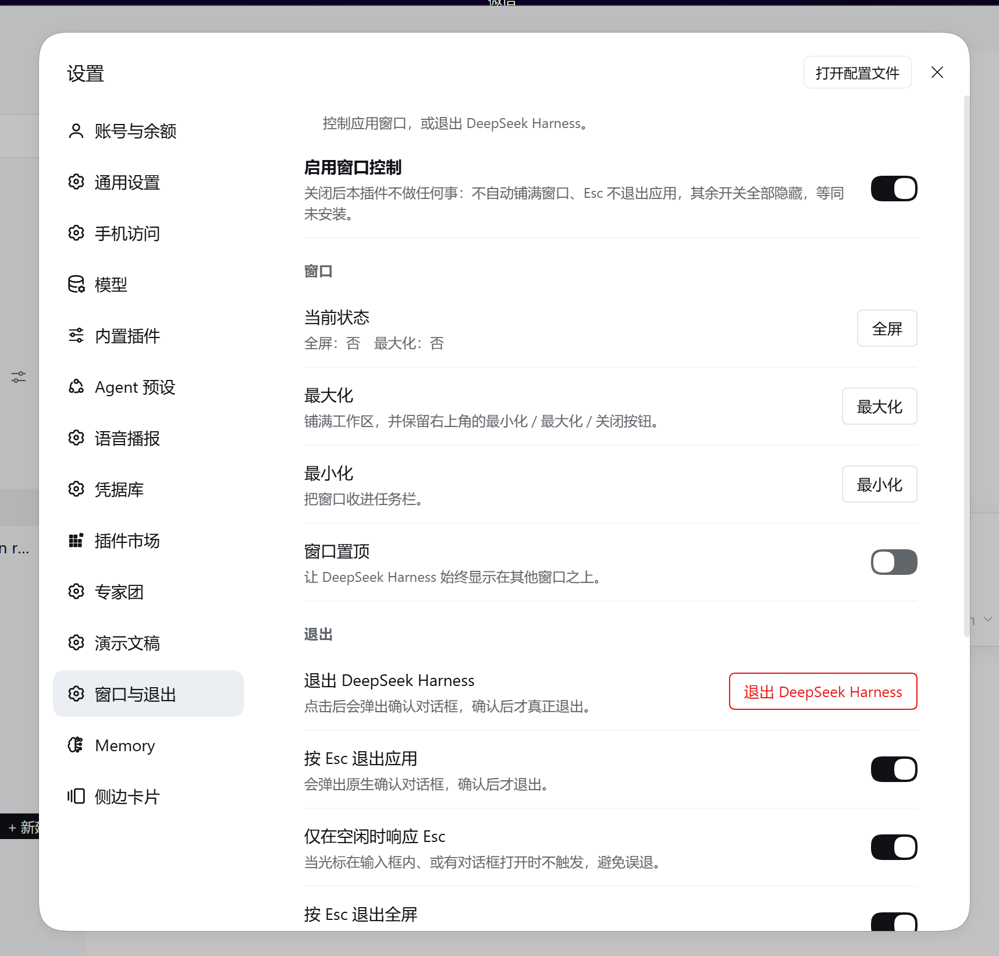
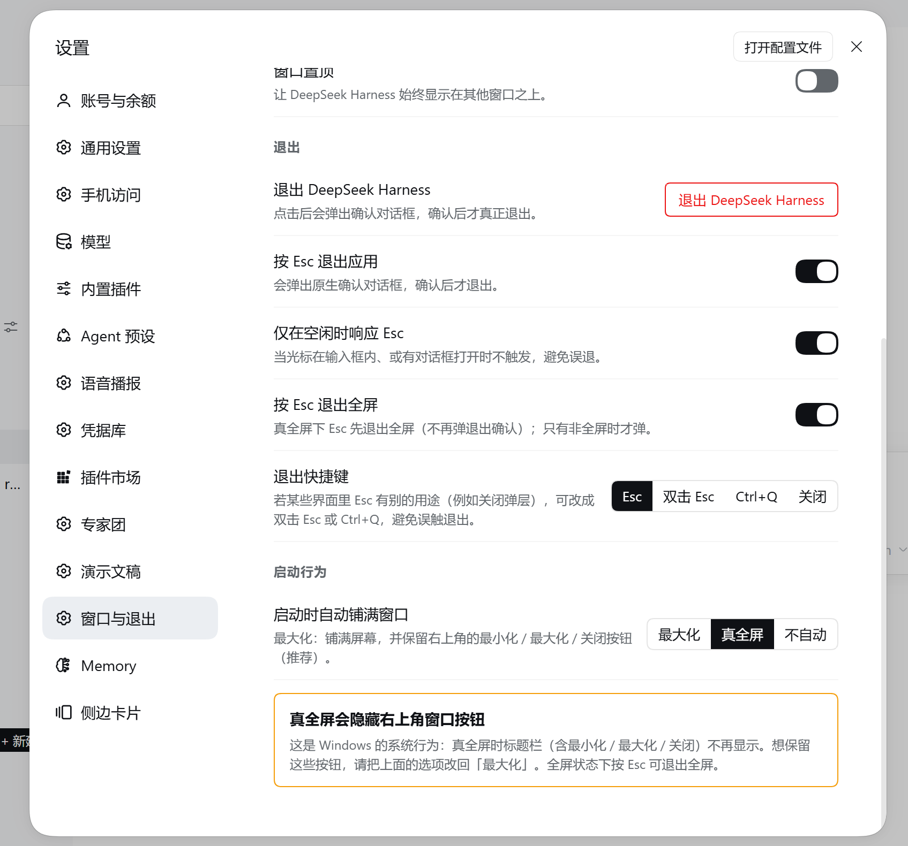

# dsh-window-control

**English** · [中文正文见下方](#中文文档)

## English

Tired of going fullscreen by hand every time you open Harness? This plugin fills the screen for
you. **Self-contained**: after install, the plugin's host half opens DSH's window channel by
itself — no extra script, no Python, and no manual file editing.

**What it does**

| Capability | Notes |
|---|---|
| Master switch | On by default. Turned off, the plugin has no effect at all (no auto-fill, no shortcut quits, all other controls hidden) and it reverts the window state it changed |
| Fullscreen / leave fullscreen | True window fullscreen (covers the taskbar), not a web-level fullscreen |
| Maximize / restore | Maximizes and restores the window |
| Minimize | Sends the window to the taskbar |
| Always on top | Keeps DSH above other windows |
| Quit DeepSeek Harness | Always shows a **native confirmation dialog** first |
| Fill the screen on launch | Three choices: **maximize (default)** / true fullscreen / off. Applies immediately, no restart |
| Quit shortcut | Four choices: **Esc (default)** / double Esc / Ctrl+Q / off |
| Leave fullscreen with Esc | On by default. In true fullscreen, Esc leaves fullscreen instead of asking to quit |

Entry point: **Settings → Window & Quit**.

**Install**

1. Add the plugin (replace the profile name to match your setup):

   ```
   dsh plugin add dsh-window-control
   ```

2. Quit DSH completely - right-click the tray icon and choose Quit. Closing the window only
   hides it to the tray, which is not a quit and the bridge will not be touched.
3. Reopen DSH (first launch) - this launch installs the window channel. The Settings -> Window &
   Quit page will say the channel is not active yet; **that is expected, not a failure**.
4. Quit DSH completely again and reopen it (second launch) - this launch reads the channel.
   Open Settings -> Window & Quit: the warning is gone and every button works. No more restarts
   are needed after this.

> ⚠️ **Why two restarts?** The DSH main process loads its code at launch, and the plugin can only
> patch the window channel while DSH is already running — so the first launch installs the channel
> and the second launch is the one that reads it. Quit DSH completely (tray icon → Quit; closing
> the window only hides it to the tray) between the two launches.

**Why it touches the host.** The DSH main process exposes no IPC channel for maximize,
minimize, always-on-top or quit — the stock `app.asar` handles none of them, and the main
window hides to the tray on close. The plugin therefore injects a small set of IPC channels
into `resources/app.asar` once (equal-length replacement, archive size unchanged, integrity
hash recomputed, backup kept as `app.asar.orig`). This is the same approach other DSH plugins
that need host behaviour take. See the Chinese section *「窗口通道是怎么装上去的」* for the
byte budget, upgrade and safety details.

**Cross-platform.** Windows (user-level install) is tested and working. On Windows under
`Program Files` the first install needs one elevated run. On macOS, modifying `app.asar` can
invalidate code signing — the plugin tells you if that happens and `restore` reverts it. On
Linux it works but with fewer path fallbacks. The archive is located by deriving the install
directory from the running DSH executable, so custom install paths are supported.

**Manual commands** (troubleshooting)

```
node lib/bridge-cli.mjs status      # is the channel installed?
node lib/bridge-cli.mjs install     # install it (add --force to reinstall)
node lib/bridge-cli.mjs restore     # put the original app.asar back
node lib/bridge-cli.mjs uninstall   # remove the channel and clean up
```

**Uninstall.** Clean uninstall is always two steps: revert the bridge **first**, then remove the
plugin - order matters.

> Why it cannot be automatic: once the plugin is removed from the profile, its host half is no
> longer loaded, so no code runs again - there is no "next launch discovers the bridge is still
> there and reverts it" opportunity. That is a hard limit of the DSH plugin model.

**Path A - command line (cleanest, recommended)**

1. Quit DSH completely.
2. Revert the bridge and clear the backup: `node lib/bridge-cli.mjs uninstall`.
3. Remove the plugin: `dsh plugin remove dsh-window-control`.

**Path B - no command line**

1. Add `config: { autoInstall: false }` for this plugin in the profile's `cordis.patch.yml`.
2. Quit DSH completely and reopen once - the host half reverts the bridge and clears the backup.
3. Once DSH is back to stock, remove the plugin from the profile.

To just revert without removing, use `node lib/bridge-cli.mjs restore` - it keeps the
`app.asar.orig` backup (use this if you plan to reinstall later). Leaving the bridge in place and
only removing the plugin also "works" - it becomes dead code - and DSH's next auto-update
replaces `app.asar` entirely, which removes it.

**Testing scope.** This plugin has only been exercised on the author's own Windows machine
running DeepSeek Harness 0.2.0-rc.2. Other operating systems, DSH versions, or
environments are unverified - it may or may not behave the same there.

**Bug reports.** If something misbehaves on your setup, please open an issue at
https://github.com/YunLiZeMeng/dsh-window-control/issues - include your OS, DSH version,
and steps to reproduce.

**Self-tests** (both run against mocks; neither touches your DSH install)

```
node _selftest.mjs          # browser half, 79 checks
node _bridge-selftest.mjs   # bridge engine, 60 checks, uses a tiny fake archive
```

MIT licensed. The rest of this document is in Chinese and goes into more depth.

---

## 中文文档

如果你嫌每次打开 Harness 都要手动全屏，这个插件可以帮你自动铺满。**自包含**：装好之后
由插件自己在后台一次性打通 DSH 的窗口通道，不需要额外脚本、不需要 Python、也不需要你手动改任何文件。

### 功能

| 能力 | 说明 |
|---|---|
| **插件总开关** | 置顶开关，**默认开**。关闭后本插件不产生任何效果（不自动铺满、快捷键不退出、其余控件全部隐藏），行为等同「未安装本插件」；同时会撤回它自己改过的窗口状态（含置顶），不影响你手动调过的窗口 |
| 全屏 / 退出全屏 | **真窗口全屏**（盖住任务栏），不是网页级全屏 |
| 最大化 / 还原 | 窗口最大化与还原 |
| **最小化** | 把窗口收进任务栏（v3 桥） |
| **窗口置顶** | 让 DSH 始终显示在其他窗口之上（v3 桥）；**勾选后会被记住，下次启动自动补上** |
| 退出 DeepSeek Harness | **无条件**先弹**原生确认对话框**，确认后才退出 |
| 启动时自动铺满窗口 | 三选一：**最大化（默认）** / 真全屏 / 不自动；改了立即生效，不用重启 |
| **退出快捷键** | 四选一：**Esc（默认）** / 双击 Esc / Ctrl+Q / 关闭。某些界面里 Esc 另有用途时，改成后两者可避免误触 |
| 按 Esc 退出全屏 | 开关，默认开；**真全屏下 Esc 先退出全屏**，不弹退出确认（否则全屏里没有可见出口）。此项始终认 Esc，与上面「退出快捷键」的取值无关 |

入口：**设置 → 窗口与退出**。





### 安装

按下面四步走：

1. **安装插件**（在终端执行；按你的 DSH 配置把 `desktop` 换成实际 profile 名）：

   ```
   dsh plugin --profile desktop add dsh-window-control
   ```

2. **完全退出 DSH** —— 托盘图标右键 →「退出」。只关窗口只是把窗口隐藏到托盘，不算退出，桥不会被处理。

3. **重新打开 DSH（第 1 次启动）**：这次启动负责把窗口通道「装上」。此时打开「设置 → 窗口与退出」会看到「窗口通道尚未生效」的提示，**这是预期内的，不是装失败**。

4. **再次完全退出并重新打开 DSH（第 2 次启动）**：这次才真正「生效」。打开「设置 → 窗口与退出」，提示消失、所有按钮可用，安装完成。此后**不再需要重启**。

> **为什么必须重启两次**：DSH 主进程的代码在启动时就被载入内存，插件只能在 DSH 跑起来之后才能去装窗口通道，所以这一轮改动要等下次启动才被读到；而装插件本身也要重启一次插件才第一次运行。于是时间线是「装插件（未运行）→ 第 1 次启动（装上桥）→ 第 2 次启动（生效）」。

如果自动安装真的被挡住（装在 `Program Files` 没写权限、macOS 签名、杀软拦截、DSH 刚升级导致拒绝注入），插件不会让你一直空转重启：连续 3 次启动读不到通道时，设置页会列出具体原因、宿主诊断文件的位置和自查命令，还有一个「复制排障信息」按钮。手动排障命令见下方「手动操作（排障用）」。

> 宿主半边在每次 DSH 启动后都会检查一次：已经装好就什么都不做（幂等），所以 DSH 升级覆盖安装目录之后，**下一次启动会自动重新装好**，你不需要做任何事。打桥前它还会把 `app.asar.orig` 与当前归档核对一遍，对不上就重做备份 —— 这样备份永远对应你正在用的这一版。

### 插件总开关（「关闭 = 等同未安装」）

总开关是唯一的全局开关，它关掉后：

1. 启动不再自动铺满；
2. `Esc` 不再触发退出（监听器仍在，但直接返回）；
3. 设置区块只剩总开关本身 + 一行「插件已停用」提示，其余控件全部隐藏；
4. 如果本次会话的窗口状态是本插件自动改的，会一并退回普通窗口。

这些判断每次都重新读配置，所以**改开关立即生效，不需要重启**。

### 为什么必须改一次宿主（而不是像普通插件那样）

DSH 的插件体系有两半，两边都碰不到主进程：

- **宿主半边**（`lib/index.js`）跑在 `ELECTRON_RUN_AS_NODE=1` 的独立 Node 子进程里，
  整个宿主包里 `BrowserWindow` 出现 **0 次** —— 没有 Electron 能力。
- **渲染端半边**（`lib/client.js`）跑在 `dsh-app://app` 的沙箱页面里，只能调用 preload
  暴露出来的东西。

而对未打补丁的官方 `app.asar` 做过逐条测绘后，结论是渲染端**拿不到任何窗口控制能力**：

- `DESKTOP_IPC` 清单里确实有 `window-fullscreen`，但它**只被 `webContents.send()`
  单向推送**（在 `enter-full-screen` / `leave-full-screen` 时告诉页面去调整 40px 标题栏），
  **没有任何 `ipcMain.handle` 注册它** —— 页面只能「听」，不能「设」。
- 官方 `dshDesktop` 暴露出的 API 只有 `browser` / `deviceInfo` / `keyboard` /
  `shortcuts` / `updates`，**一条窗口控制都没有**。
- `windows-menu`（Windows 系统菜单）只认 `application` / `edit` 两种菜单（撤销、复制、
  粘贴），而且它只挂在 preload 自己的 shadow DOM 上、没走 `contextBridge`，页面调不到。
- profile 的 `cordis.patch.yml` 是**加载器层**补丁（改配置、禁用插件、插入插件 id），
  注入不了主进程代码。

所以窗口控制必须改宿主。这也正是 `dsh-desktop-tray` 之类插件同样自带
`main-patch.js` 的原因。

### 能不能做到「装完即用」或「只重启一次」

做不到 —— 这是 DSH 的结构决定的，不是没做优化。三条都验证过：

1. **窗口能力只能活在主进程里，而主进程的代码在启动那一刻就载入了。**
   对原版 `lib/main.js` 逐字统计：`maximize(`、`minimize(`、`setAlwaysOnTop(` 各 **0 次**；
   `setFullScreen(` 只有 1 次，还是 macOS 上「隐藏窗口前先退出全屏」用的；
   `restore()` 只在开文件对话框前把最小化的窗口叫醒。也就是说**没有任何一条现成通道**能被
   外部触发来控制窗口，桥必须自己写进去；而写进去的字节，只有等主进程**下一次启动**才会被读到。
2. **主进程没有对外暴露「重启」。** `app.relaunch()` 确实存在，但它只挂在崩溃恢复对象
   `DesktopFatalRecovery` 内部（`exit` / `restart` / `writeReport`），没有任何 IPC 通道通向它，
   所以「装完桥自动重启一次」也没法做；从外部强杀再拉起更是不可接受。
3. **插件只有等 DSH 起来之后才有执行权。** `main.js` 里没有任何文件监听
   （`fs.watch` / `watchFile` / `chokidar` 均为 0），`cordis.patch.yml` 的「hot-reloaded」
   指的是长驻面重新加载时重读，不是监听文件。所以装插件本身就要重启一次，插件才第一次运行。

于是时间线只能是：**装插件（插件未运行）→ 第 1 次启动（插件装上桥，本次读不到）→
第 2 次启动（桥生效）**。其中第 1 次本来就是装插件必需的重启，本插件额外增加的是 1 次。

三条「理论上能绕过去」的路，都不成立或不划算：

| 思路 | 为什么不采用 |
|---|---|
| 安装期执行代码（postinstall） | 市场明确把「install-time code execution」列为红线；而且用户还没看到插件就改了他的安装目录 |
| 纯渲染端 API（`requestFullscreen` / `moveTo` / `close`） | 只能做视觉全屏；最大化、还原、最小化、置顶一律做不到，`close()` 还会被主窗口 `preventDefault()` 收进托盘，根本不是退出 |
| 系统级操控窗口（Win32 `ShowWindow` / AppleScript / `xdotool`） | 只在 Windows 上可行，还要 PowerShell 或原生依赖；macOS 要辅助功能授权，Wayland 下直接失效；且「Esc 退出」还要另开一条渲染端 → 宿主的通道。比打桥脏得多 |

**真正的零重启出路在官方这边**：只要 DSH 哪天开放窗口通道，本插件立刻变成「装完即用」——
`client.js` 的 `bridge()` 已经同时认 `window.dshDesktop.windowControl` 这个官方预留位，
届时**不需要改一行代码**，也不用再重启两次。

### 窗口通道是怎么装上去的

`lib/asar-bridge.js` 对 `resources/app.asar` 里两个文件做**等长就地替换**：把两段
纯文档注释换成注入代码（空格补齐到原长度），并**原位更新**头部里这两个文件的
`integrity.hash`。归档总大小、头部长度都不变，**其余条目逐字节未动**（改了几个条目就只写几个条目的字节；实际条目数随 DSH 版本变化，可用 `node lib/bridge-cli.mjs status` 看当前值）。

```
lib/main.js         加 839 字节 → 注册 4 条 IPC
lib/preload-app.cjs 加 384 字节 → 暴露 window.dshWindowControl
```

新增的 6 条通道（v3 起）：

```
dsh-desktop:window-state            读取 { fullscreen, maximized, minimized, top }
dsh-desktop:window-fullscreen-set   设置窗口全屏
dsh-desktop:window-maximize         最大化 / 还原
dsh-desktop:window-minimize         最小化（v3）
dsh-desktop:window-top              窗口置顶 / 取消置顶（v3）
dsh-desktop:app-quit                弹原生确认框，确认后退出
```

preload 另暴露 `window.dshWindowControl.v`（当前为 `3`），供渲染端判断能力级别：
`>= 2` 表示支持退出前的原生确认框，`>= 3` 额外支持最小化与窗口置顶。
渲染端对 v3 能力做了方法级探测，旧桥上「最小化 / 置顶」会自动置灰而不是点了没反应。

#### 字节预算

注入块是**等长替换**，容量有限，实测占用：

| 文件 | 替换块 | 已注入 | 剩余 |
|---|---|---|---|
| `lib/main.js` | 1000 | 953 | 47 |
| `lib/preload-app.cjs` | 504 | 432 | 72 |

通道名因此在代码里统一拼成 `P + 后缀`（`P = "dsh-desktop:"`）—— 写完整字符串的话
6 条通道就放不下了。想再加功能，得先压缩现有实现腾字节。

#### 版本升级

桥一旦装上，锚点注释就没了，无法原地把旧代码换成新代码 —— 升级只能「先用
`app.asar.orig` 还原成原版，再重新注入」。所以 `install()` 会比较归档里的实际版本与
本版插件的目标版本（`BRIDGE_VERSION`），落后就自动走这条路，**老用户不需要手动做什么**。

唯一的例外是备份丢失：没有原版备份就无法还原，也就无法升级。这种情况下插件会明确
提示，而不是静默停留在旧版本。

#### 安全性

- **首次改动前一定先备份**到 `app.asar.orig`。
- **注入前全量自检**：按官方同一套算法重建目标条目并复算 sha256、核对头部等长、
  确认其余条目不受影响；自检不通过**绝不动线上文件**。
- 为什么用就地替换而不是重写归档：实测在 DSH 运行期间
  `open(asar, 'r+')` 成功、`rename(asar, …)` 会 `EBUSY`（Electron 持有句柄）。
  等长替换天然只需要原地覆盖几百字节，不需要换文件，因此运行中也能安全落盘。
- 注入代码是纯 ASCII，长度受「可替换块大小」硬约束，超长会直接拒绝而不是静默截断。
- **注入前符号预检**：先确认目标文件里存在注入代码要依赖的符号（`assertDesktopSender` 等）。
  DSH 升级改了这些代码时会直接拒绝，而不是把代码塞进不匹配的位置。
- **头部哈希按条目精确定位**：正常情况旧哈希在头部只出现两次（`integrity.hash` 与
  `integrity.blocks[0]`），直接等长替换；如果归档里恰好有**内容完全相同的另一个条目**
  （sha256 一样、旧哈希会出现 4 次），改成用本条目唯一的 `offset` 做锚点只改自己的两处，
  不会把别的条目的完整性改坏。
- **没有完整性块的条目也能装**：归档没写 `integrity` 时跳过写哈希（那种情况下 DSH 也不校验），
  不会因为归档格式上的一点差异就永久拒装。
- **并发锁**：改动期间持有锁文件，两个 DSH 实例同时启动时第二个直接跳过。
- **写入权限预检**：动手前先确认写得了。装在 `Program Files` 这类需要提权的位置时，
  会给出「以管理员身份运行一次」这类可操作的提示，而不是抛一个 `EACCES`。
- **读取不再整档载入**：只解析归档头 + 定向读两个目标条目（实测 93 ms/115 MB → 约 25 ms/4 MB），
  内存峰值也从约 120 MB 降到几 MB。

### 手动操作（排障用）

宿主半边会自动处理，正常情况用不到。需要时：

```bat
node lib/bridge-cli.mjs status      :: 看当前状态（未安装 / 已安装 v3 / 锁 / DSH 是否在运行）
node lib/bridge-cli.mjs check       :: 只构建 + 全量自检，不落盘（已打桥时自动改为校验 .orig 备份）
node lib/bridge-cli.mjs install     :: 手动安装（幂等）
node lib/bridge-cli.mjs install --force   :: 已打过桥也先还原再重打一遍
node lib/bridge-cli.mjs restore     :: 从备份还原 app.asar
node lib/bridge-cli.mjs restore --force   :: 归档没打过桥也照写
node lib/bridge-cli.mjs uninstall  :: 撤桥 + 清理备份（卸载插件时用它）
node lib/bridge-cli.mjs bench       :: 测一次读取/构建耗时（排障用；已打桥时同 check 一样看备份）
```

> `check` / `bench` 在**已经打过桥**的机器上照样能用：桥装上之后锚点注释已被注入代码替代，
> 对着线上归档原地构建必然失败 —— 而这恰恰是最常见的排障现场。所以它们会自动改看
> `app.asar.orig`（那就是原版），它能否构建通过，正好回答「DSH 升级后本版插件还能不能注入」。

排障还可以看这两个地方：

- 宿主日志：搜 `[dsh-window-control]`。
- 状态文件：`~/.dsh/profiles/desktop/.dsh-window-control.json`（记录上次启动装没装、为什么没装）。

宿主侧也可以关闭自动安装（例如企业镜像不允许插件碰安装目录）。在 profile 的
`cordis.patch.yml` 里给本插件加 `config: { autoInstall: false }` 即可，此时插件只剩
渲染端那部分能力。

### 卸载

本插件除了代码，还会往 DSH 安装目录的 `resources/app.asar` 里**打一段桥**（用来真正控制窗口）。
所以干净卸载永远是**两步：先撤桥、再删插件** —— 顺序不能反。

> 为什么不能反过来、也不能「删插件自动还原」：插件一旦被移出 profile，它的宿主半边就不再被加载，
> 没有任何代码会再执行，也就不存在「下次启动发现桥还在、插件已不在、顺手还原」的机会。这是 DSH
> 插件机制的硬限制，不是偷懒。

**路径 A — 命令行（最干净，推荐）**

1. 完全退出 DSH（托盘 → 退出）。
2. 撤桥并清掉备份：

   ```
   node lib/bridge-cli.mjs uninstall
   ```

3. 移除插件：

   ```
   dsh plugin --profile desktop remove dsh-window-control
   ```

`uninstall` 会把 `app.asar` 还原成原版**并删除 `app.asar.orig` 备份**（幂等，多跑无害）。

**路径 B — 不用碰命令行**

1. 在 profile 的 `cordis.patch.yml` 里给本插件加 `config: { autoInstall: false }`。
2. 完全退出 DSH 并重新打开一次 —— 宿主半边会主动撤桥并清掉备份。
3. 确认 DSH 已回到原版（设置页不再有本插件的入口）后，再把插件从 profile 移除。

**只想还原、暂时不删**：用 `node lib/bridge-cli.mjs restore`。它与 `uninstall` 的区别是
**保留 `app.asar.orig` 备份**（方便日后重装）。`restore` 有护栏：归档没打过桥时会直接拒绝，
避免把旧备份写回去导致「新 exe + 旧资源」的降级。

> 懒得管那层桥也可以：只删插件、不撤桥也「能用」—— 桥留在 `app.asar` 里只是没人调用的死代码；
> 而且 DSH 下次自动更新会整体替换 `app.asar`，桥自然就没了。只是那之前你的 `app.asar` 不是原版。

写入失败会自动回滚：`install` 落盘后一定复验一次，对不上就立刻用备份把归档还原回去，绝不留半写状态的 `app.asar`（那种状态下 DSH 连启动都做不到）。

### 跨平台情况（换一台电脑还能不能用）

先说结论：**Windows 上换机能用**；其它平台能用，但各有前提。

| 平台 | 状态 | 前提 / 说明 |
|---|---|---|
| Windows（默认装到用户目录） | ✅ 可用 | 本机就是这种，已实测：自动装桥 → 重启 → 生效 |
| Windows（装在 Program Files） | ⚠️ 需要提权一次 | 写入需要管理员权限。插件会明确提示，以管理员身份运行一次 DSH 即可，之后日常使用不再需要 |
| Windows（任意自定义路径） | ✅ 可用 | 不靠猜路径：宿主进程由 DSH 自己的 exe 拉起，据此推出安装目录，所以装在哪都能找到 |
| macOS | ⚠️ 有签名风险 | 若 DSH 做过代码签名与公证，改 `app.asar` 可能使签名失效，Gatekeeper 可能拒绝启动。插件装成功后会如实提示；出问题执行 `restore` 即可恢复，无需重装 |
| Linux | ⚠️ 可用但覆盖有限 | 主路径同样是「由 exe 位置推出」，另有 `/opt`、`~/.local/share` 等兜底候选 |

**首装请重启两次**（第一次装上、第二次生效）；DSH 自己升级覆盖掉归档之后同理 ——
下一次启动会自动重新装好，再下一次生效。装不上时界面会自己给出原因和自查办法，
不会让你反复重启（见上一节的提示框）。

定位顺序是：显式指定 → `DSH_ASAR` 环境变量 → 进程信息（最可靠，覆盖自定义路径）→
平台默认路径。一次都找不到时不会静默失败，状态文件里会留下完整诊断
（argv / execPath / 每个候选是否存在 / 用的是哪套 fs）。

还有两条与机器无关的保险：

- **并发锁**：同时开两个 DSH 实例时，第二个会看到锁并跳过，不会两个进程同时改同一个归档。
- **注入前符号预检**：DSH 升级后如果锚点代码变了，会明确拒绝并说明「DSH 版本可能已变化」，
  而不会把注入代码塞进不匹配的位置。

改安装目录这件事还有一类绕不开的干扰：**杀毒软件 / 企业管控可能拦截对安装目录的写入**。
这不属于插件能处理的范围，遇到时表现为写入失败（插件会自动回滚并保持原样），
把安装目录加入白名单即可。

### 测试范围与 Bug 反馈

本插件**只在作者自己的 Windows 设备上、配合 DeepSeek Harness 0.2.0-rc.2 实测过**；其它操作系统、DSH 版本或环境均未验证，能否正常工作说不准。

如果在你机器上出现异常，欢迎去 [Issues](https://github.com/YunLiZeMeng/dsh-window-control/issues) 提一个 issue，最好带上：

- 操作系统与 DSH 版本
- 复现步骤
- 插件状态文件 `~/.dsh/profiles/desktop/.dsh-window-control.json` 的内容（出问题时界面会提示它的位置）

### 为什么「启动自动铺满」的默认值是「最大化」而不是「真全屏」

DSH 主窗口在 Windows 上是这么建的：

```js
new BrowserWindow({
  titleBarStyle: 'hidden',                                   // 不要系统标题栏
  titleBarOverlay: { height: 40, color, symbolColor },       // 但让系统在右上角画 40px 覆盖层
})
```

也就是那个覆盖层是 **Windows 系统画的最小化 / 最大化 / 关闭按钮**。而 Windows 的规则是：
**窗口一旦进入真全屏（`setFullScreen(true)`），整个标题栏覆盖层会被一起隐藏** ——
任何应用都如此，不是插件写坏了。这就是曾经「插件跑起来后右上角三个按钮都不见了」的原因。

最大化和真全屏一样铺满屏幕，但保留覆盖层，**右上角三个按钮照旧可用**，所以现在是默认值。
真全屏仍保留为可选项（需要连任务栏一起遮住时用），选中时设置页会给出提示。

> 顺带一提：DSH 渲染端用 `html[data-windows-titlebar]` + `--dsh-windows-titlebar-height: 40px`
> 给这 40px 预留了位置，所以最大化状态下布局与原生按钮是严丝合缝的。

### 退出为什么自己弹框（而不是用 DSH 自带的）

DSH 主进程确实有退出确认（`before-quit` → `DesktopQuitConfirmation`），但它是**有条件的**：

```js
function resolveDesktopQuitPrompt(inspection) {
  if (inspection === 'unknown') return 'quitActiveTasks'
  if (inspection.activeTasks) return 'quitActiveTasks'
  if (inspection.scheduledTasks) return 'quitScheduledTasks'
  // 两者都没有 → 返回 undefined
}
// decide(): if (prompt === undefined) return true   ← 不弹框，直接退出
```

也就是说：**没有运行中的任务、也没有武装的定时提醒时，按 Esc 会静默退出**（这就是曾经
「按了 ESC 就直接退出」的原因）。

所以本插件改成自己弹框：

1. 渲染端把文案（标题 / 正文 / 说明 / 按钮）通过 `dsh-desktop:app-quit` 传给主进程；
2. 主进程用 `dialog.showMessageBox(window, options)` 弹**真·原生**框（带应用图标、窗口模态）；
3. 用户点「退出」才 `app.quit()`；点「取消」什么都不做；
4. 退出前顺便置位模块级 `skipQuitConfirmation`，让 DSH 自己的那次条件弹框不再重复出现，
   而 `finishQuit()` 的清理照常执行。

桥缺失时渲染端退回 `window.confirm`，保证「退出必确认」在任何情况下都成立。

### 配置存放位置

渲染端把设置存在 `localStorage`（origin = `dsh-app://app`），键名
`dsh-window-control:settings`，字段：`enabled`（总开关）、`startMode`
（`'maximized'` / `'fullscreen'` / `'off'`）、`escQuit`、`escGuarded`、
`escExitFullscreen`。同步可读，因此「启动时自动铺满」能在页面加载的最早时机生效。

旧版本（≤1.0.0）只存布尔量 `startFullscreen`，读取时自动迁移：
`true`（旧默认）→ `'maximized'`（不再默认真全屏，避免右上角按钮消失），
`false` → `'off'`。旧字段不会被删除，只是不再使用。

### 目录结构

```
lib/index.js         宿主半边：每次启动自动检测 / 安装 / 记状态；autoInstall=false 时撤桥
lib/asar-bridge.js   桥引擎：asar 读写、注入、自检、回滚（纯 Node，零依赖）
lib/bridge-cli.mjs   同一个引擎的命令行入口（排障用）
lib/client.js        渲染端：设置区块 UI + Esc 处理 + 启动铺满
locale/zh.json       插件在市场里的标题与描述（中文；界面文案在 lib/client.js）
locale/en.json       插件在市场里的标题与描述（英文；界面文案在 lib/client.js）
icon.svg             插件图标
cordis.patch.yml     bundle 层挂载声明
```

界面文案同时提供两套：优先接 DSH 的 Client locale 服务（跟随应用语言设置），
拿不到就按 `navigator.language` 选内置字典 —— 两条路都可用，所以不会因为
locale 服务缺席而没文案。

### 开发自测

```bat
node _selftest.mjs          :: 渲染端沙箱自测，当前 79/79 通过
node _bridge-selftest.mjs   :: 桥引擎自测，当前 60/60 通过
```

桥引擎自测在临时目录里造**微型假 asar**（不碰真的归档文件，也不依赖它），
复刻了真归档的全部结构约束，覆盖：安装 / 幂等 / 自检 / 回滚 / 卸载还原 /
并发锁 / 符号预检 / 锚点漂移 / 权限不足。

真实归档上的端到端验证另外做过：构建 / 自检 / 安装 / 回滚全部通过，
全量逐条目 sha256 复算零不一致（条目数随 DSH 版本变化；用 `node lib/bridge-cli.mjs check` 可对你这一版复测，
它的「其余 N 个条目不参与改动」一行就是当前条目数），且产物与早期 Python 版实现**逐字节完全相同**。
